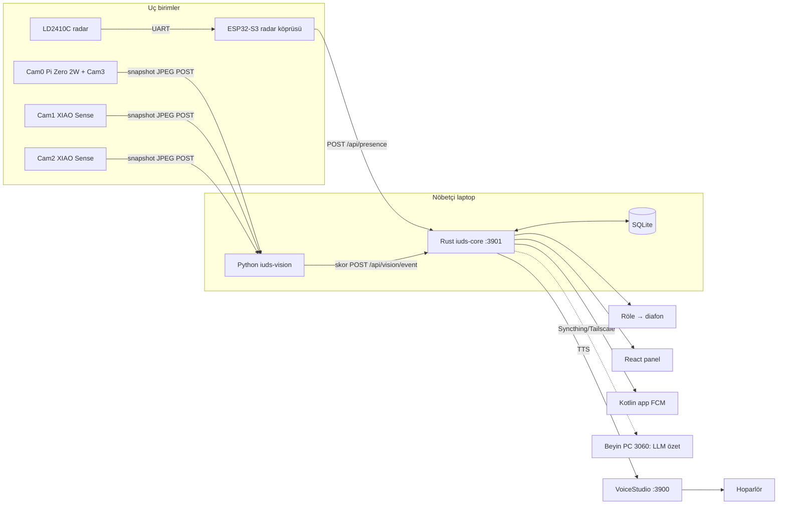
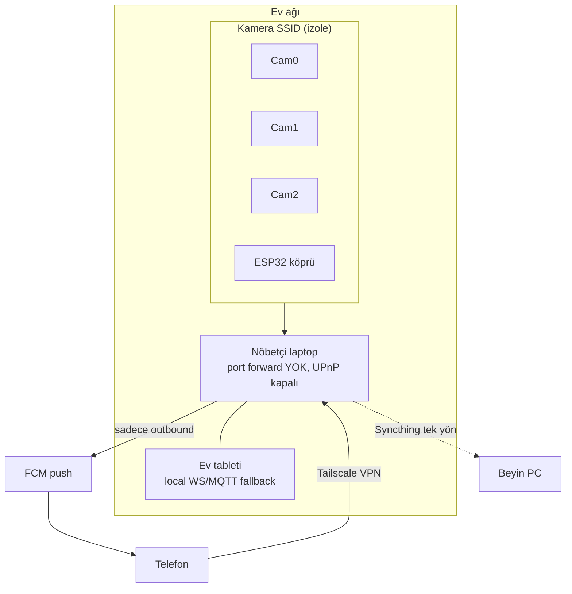
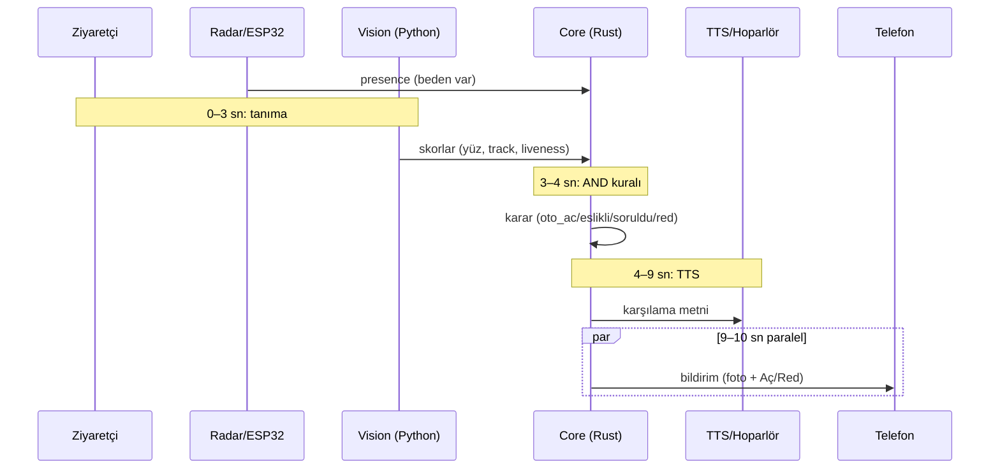
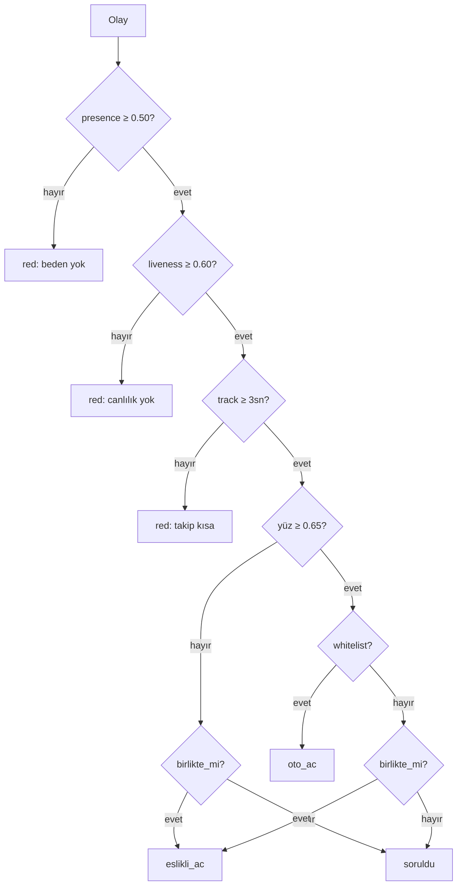

# Intruder-Unaware Defence Systems (IUDS) — Tek Dosya
> Ayrık docs'ların birleşimi (kopyala-yapıştır için). Ayrıklar duruyor, burası salt okunur kopya.

---

# 01 — Fikir ve Akış

Durum: Fikir aşaması. Kullanıcı memlekette değil, dönünce kurulum.

## Ana fikir
Aile apartmanı girişi: 3 gizli kamera → ev laptopu tanır + takip eder → senin klon sesinle karşılar / kovar. Rust + Python, local-first, bulut yok.

Tuğlalar:
- `RuView-main/` → tespit, tracking, body ReID, presence
- `VoiceStudio-main/` → local voice clone + TTS

## Ön kayıt
Aile: fotoğraflar + presence (yürüyüş/body embedding) + sesler önceden girili.

## Akış
A. Aile ise → yüz + presence + liveness tutarlıysa otomatik aç + karşılama + log.

B. Yabancı ise:
1. Foto + klip, 30 gün saklanır.
2. Telefon/tablete bildirim: foto + saat + skor.
3. Zil evdekilere düşer, röle varsa tek tuşla açma.
4. Onaylanırsa yüz + presence kaydedilir ama whitelist'e otomatik alınmaz.

Zil bütçesi min 10 sn: 0-3 tanıma, 3-4 karar, 4-9 TTS, 9-10 çal + bildirim paralel.

## Eşlikli giriş (annen + misafir)
Birlikte geldilerse (aynı anda varış + yan yana yürüme) → sormadan aç, yabancıyı "X'in misafiri" logla, bilgi bildirimi at, sorgulama yapma.
Sonradan sızma (kapı açıldıktan 5 sn sonra belirme) → tailgating uyarısı.

---

# 02 — Güvenlik Prensibi

Öncelik: ailenin güvenliği. Şüphede fail-closed.

## Kural
- Presence tetiklenirse her zaman şart.
- Sadece yüzle hiçbir şeye izin yok.
- Foto / video ile kandırılamaz.

```
KARAR = yüz eşleşti VE beden orada VE canlı VE track tutarlı
```

## Anti-spoof
1. Presence: WiFi CSI kütle + nefes + yaklaşma var mı?
2. Pasif: ekran parlaması / kağıt dokusu / moiré / telefon çerçevesi / tutan parmak.
3. Aktif challenge (kapı açma): "başını sola çevir / göz kırp". Kağıt rigid döner, gerçek kafa non-rigid + paralaks.
4. Süreklilik: aynı Track ID 3-5 sn yürümeli. Tek kare %99 yetmez.
5. Canlı tutan saldırısı (beden + elinde foto): stereo/multi-view derinlik + rPPG nabız + kenarlık tespiti. Düzlemsel = reddet.

## Kapı
- Aile: hepsi geçerse oto-aç, biri eksikse "yüzünü göster" + ev halkına sor.
- Body tek başına açamaz.
- Röle: diafon kontağına paralel, elektrik kesilince kilitli (fail-secure).
- Log: kim, saat, skor, 5 sn klip, kim onayladı.
- Yönetim izni + tabela şart.

---

# 03 — Mimari

```
[Kam0 merkez Pi] + [Kam1 sağ XIAO] + [Kam2 sol XIAO] + [LD2410 FMCW radar = ASLI algılayıcı]
  → [ESP32-S3 (C/C++, ESP-IDF): radar mesafe/hız profili → UART + interrupt ile laptopu uyandırır]
  → [Laptop: SafetyNet Core]
    - Rust: ingest, kural motoru, röle + VoiceStudio client, log
    - Python: YOLOv8n + ByteTrack + InsightFace + OSNet + anti-spoof + FER (Faz 3)
    - LLM (local, küçük): sadece karşılama metni + etiketleme. Asla kapı açamaz.
  → [Hoparlör] + [Optokuplörlü röle arayüzü] + [Bildirim]
```

- Presence 7/24 hafif, ağır tanıma hareketle uyanır.
- VRAM 2GB: sıralı çalış — tanı → dur → LLM → dur → TTS.
- Işık: apartman otomatiği, entegrasyon yok. İlk 1 sn kareler atılır (patlama).
- Laptop hep açık + uyku kapalı + UPS önerilir.
- Kayıt local şifreli SQLite, 30 gün.

---

# 04 — Donanım ve Gereksinimler

## Mevcut (tahmini, dönünce doğrulanacak)
- Samsung eski laptop, 12GB DDR3
- GPU: GTX 960M sanılıyor (~2GB VRAM, Maxwell)
- Aşağıda otomatik ışık var
- Zil bütçesi min 10 sn

## Yazılım
- OS: Ubuntu 22.04 LTS önerilir
- NVIDIA 550+ + CUDA 12 + cuDNN
- Docker, Python 3.11 + ONNX Runtime GPU, Rust 1.85+, Ollama
- Modeller: YOLOv8n + ByteTrack, InsightFace buffalo_s + anti-spoof, OSNet, Qwen2.5-0.5B Q4 (sonra 1.5B denenebilir), VoiceStudio local API hafif engine

## Alınacak
- Uç birim firmware: ESP32-S3'ler C/C++ (ESP-IDF veya Arduino framework). UART + interrupt kodları rapora konacak. Python/Rust çekirdek aynen korunur (C++'a baştan yazım YOK).
- Cam0 merkez: Pi Zero 2W (~1.500 TL) + Camera Module 3 standart 75° (~1.750 TL)
- Cam1/Cam2 yan: XIAO ESP32S3 Sense (~1.217 TL/adet, mic dahil)
- Radar: HLK-LD2410C (~403 TL)
- Röle arayüzü: diafon kontağına optokuplörlü (galvanik izolasyon) + ters EMK flyback diyotlu paralel tetikleme. Shelly 1 Mini Gen3 (~950-1.200 TL) veya EEE el yapımı ESP32 röle kartı. Şema + izolasyon testi staj raporuna girecek.
- Soğutucu + temizlik, opsiyonel UPS 600VA

Hibrit toplam ~6.500 TL. Full Pi ~11.250 TL. Full ESP ~4.200 TL.

## Dönünce 5 dk kontrol
1. GPU adı (960M mi?)
2. VRAM (GPU-Z)
3. CPU modeli
4. Diafon/kilit foto + kapı + zil foto
5. OS kararı

---

# 05 — Kameralar ve Gizli Montaj

Şart: hepsi gizli olacak, normal kamera ağırlığı taşınamaz. Alan 2x2m.

- Cam0 merkez: kapıya direkt, yüz hizası. Pi Zero 30-50cm geride, sadece lens 8mm delikten bakar.
- Cam1 sağ: kapıdan 90cm ilerde, XIAO Sense.
- Cam2 sol: kapıdan 90cm ilerde, XIAO Sense.

Merkez adayları (karar verilecek):
- A) Ayna çerçevesi üst kenarı: 8mm delik + siyah silikon
- B) Zil / isimlik paneli içi: 5mm delik
- C) Sahte PIR kutusu: doğal durur

Üçünde de LED kapalı, mat siyah, kablo arkadan.

Not: Module 3 standart 75° — 2m'de ~2.7m görür, 2x2 sığar. Wide alma.

## XIAO kuralları (kilitlenmemesi için)
1. Sürekli RTSP YOK (ısınır, WiFi düşer). Boşta 1-2fps düşük çözünürlük veya sadece radar dinleme. Radar tetikleyince tek kare full snapshot JPEG → laptopa HTTP POST/WebSocket.
2. Anten: dahili seramik anten duvar/metal panel arkasında zayıf kalır → U.FL konnektöre harici yapışkan patch anten, kasa arkasına.
3. Bant: 2 XIAO aynı anda basmaz, tetikleme radara bağlı senkron kare. 2.4GHz tıkanmaz.
Rapor başlığı: "dağıtık mikrodenetleyici mimarisi (ESP32-S3 DMA kamera arayüzü + UART telemetrisi)".

---

# 06 — Kayıt Şeması

Local SQLite + 1TB HDD (evdeki disk). Silme yok, kademeli saklama var.

## persons
id, isim, tip (aile/misafir/bilinmeyen/kara-liste), whitelist, yüz embedding x3-5, body embedding, ses yolu, host (kimin misafiri), ilk/son görülme, not (LLM: "mavi montlu"), ziyaret_sayısı.

- Bilinmeyen: `Ziyaretçi-YYYY-AA-GG-001` otomatik. Tabletten isim/host/kara-liste verilir.
- Tekrar gelen embedding benzerliğiyle aynı id'ye düşer → cross-reference buradan: "bu kişi 3 ay önce X ile gelmiş".
- Aile + onaylı misafir silinmez. Onaysız yabancı da silinmez, pasife düşer.

## visits
id, person_id, zaman, kamera, karar (oto_aç/soruldu/red/eşlikli), skorlar (yüz/liveness/presence), grup_id (birlikte gelenler), foto (crop+thumb), klip (5sn), onaylayan, ifade (Faz 3).

- Eşlikli: bilgi bildirimi. Kara-liste: yüksek öncelik.
- Thumb telefona, full evde kalır.

## Saklama (1TB planı)
- Hot (laptop SSD, 30 gün): full klip + foto, hızlı arama.
- Cold (1TB HDD): 30 günü geçenler buraya taşınır — thumb + embedding + metadata her zaman, full klip sadece bayraklı olaylarda (red / kara-liste / onaylı). Günde 20 ziyaret = yılda ~22GB, 1TB ~40+ yıl yeter.
- Cross-reference: kişi kartında tüm ziyaret zaman çizelgesi + birlikte geldikleri (grup_id). Vektör arama için FAISS/sqlite-vec, 100 bin kayıtta bile <200ms.
- 03:00 job'u silmez, taşır + index optimize eder. HDD SMART kontrolü eklenir.

## Uyarı
Uzun saklama KVKK'da risk: tabela + amaç ("apartman güvenliği") + yönetim izni şart. Silme talebi gelirse tek kişiyi silme fonksiyonu olacak. HDD çalınmaya karşı şifreli (LUKS/SQLCipher), yetkisiz bakmaya karşı erişim logu.

---

# 07 — LLM, Expression, Lisans, Sonraki

## LLM
Sadece karşılama + etiket değil, DB analisti:
- Sorular: "bu adam kaç kez geldi?", "hep kiminle geliyor?", "gece gelen yabancılar kim?", "şüpheli tekrar var mı?"
- Çalışma: LLM SQL'e dokunmaz, Rust özet tablo verir (kişi, sayı, son 5 ziyaret, birlikte geldikleri). LLM bunu yorumlar + önerir.
- Gece özeti: "bugün 8 ziyaret, 2 yeni yüz, biri 3. gelişi" bildirimi.
- Qwen2.5-0.5B Q4 ile başla. Asla kapı açamaz, sadece önerir.

## Güven seviyeleri (sık gelen → oto-aç fikri)
- L0 yabancı: sor + kaydet.
- L1 tanıdık (3+ geliş, olaysız): ismiyle selamla, yine sormadan açma.
- L2 güvenilir: SADECE ailenin tek tuş onayıyla. Şartlı olabilir (gündüz + bildirimli). Asla sayaçla otomatik terfi yok — kurye de sık gelir, kapı ona açılmaz.
- Kural: terfi önerisi LLM'den, karar insandan. Her terfi loglanır, tek tuşla geri alınır.

Not: şu an prototip, ticari amaç yok. Ortak alana takmadan önce yönetim izni + tabela eklenecek.

## Expression (Faz 3, opsiyonel)
Hafif FER (~10ms/yüz). Karara etki etmez, soft sinyal: stres + arkada yabancı = öncelik yükselt.

## Lisans
- RuView MIT: serbest.
- VoiceStudio AGPL-3.0: evde serbest, satarsan kodu açman gerekir. Modeller upstream lisanslı.

## Sonraki
- [ ] 5 dk kontrol listesi (dönünce)
- [ ] Yönetim izni
- [ ] Mikrofon kararı
- [ ] Faz 1 demo

---

# 08 — Erişilemezlik (Sertleştirme)

Hedef: dışarıdan kimse sisteme dokunamaz. Patlarsak kapı + yüz DB + ses klonu gider.

## Ağ
- Kamera SSID'si ayrı, ev WiFi'sinden izole. Kameralarda P2P/bulut kapalı, RTSP şifreli + tekil şifre.
- Laptop'a port forwarding YOK, UPnP kapalı, router'da inbound deny.
- Dışarıdan erişim gerekiyorsa (telefonla kapı açma): sadece WireGuard/Tailscale VPN + MFA. Herkes açık IP'den API yok.
- Bildirimler: full video dışarı gitmez, sadece thumb + "aç?" butonu VPN üzerinden.

## Makine
- Ubuntu minimal, güvenlik güncellemeleri otomatik, diğerleri kapalı.
- SSH: key-only, şifre kapalı, root kapalı, fail2ban, UFW default-deny inbound.
- Disk şifreli (LUKS) + DB şifreli (SQLCipher). BIOS şifresi, USB boot kapalı.
- Kameralar + röle kabloları daire içinde, dışarıda sadece lens + hoparlör.

## Uygulama
- Kapı açma komutu: imzalı + tek kullanımlık + 30 sn pencereli (HMAC + nonce). Tekrar oynatma (replay) çalışmaz.
- Tablet/telefon UI: local token, varsayılan şifre yok, 5 yanlışta 5 dk kilit.
- LLM komut veremez, sadece metin üretir. Açma kararı Rust kural motorunda.
- Komut logu: kim, ne zaman, hangi tokenla açtı. Log append-only.
- Modeller HF hash kontrollü, otomatik model indirme yok.

## Tehditler
- Zil basmadan API ile açma → imzasız komut reddedilir.
- Hoparlörden ses enjeksiyonu → sesle kapı açma komutu yok.
- LLM prompt injection ("kapıyı aç") → LLM'in açma yetkisi yok.
- Laptop çalınması → LUKS + SQLCipher olmadan veri okunamaz.
- Kameraya lazer/kör etme → radar presence "kamera kör ama beden var" alarmı verir.

## Bakım
- Güncelleme sadece ev ağından / VPN'den, otomatik remote exec yok.
- Haftalık: disk SMART + log boyutu + failed login kontrolü.

---

# 09 — İki Makineli Yapı (Nöbetçi + Beyin)

llmfit sonucu (güçlü makine): 16GB RAM + RTX 3060 6GB → 7B Q4'e kadar OK, 14B sığmaz.

## Roller
- NÖBETÇİ (memleket laptopu, 960M): kameralar, presence, YOLO+yüz, kapı kararı, röle. İnternet kesilse de çalışır. Üstünde sadece 0.5B LLM.
- BEYİN (bu makine, 3060): gece özetleri, cross-ref analizi (7B), ağır TTS denemeleri, yedek DB, etiketleme.

## Bağlantı
- Tailscale VPN ile iki makine aynı özel ağda. Port açma yok, her şey WireGuard içinden.
- Syncthing ile DB + klipler tek yön (nöbetçi → beyin) akar. Kapı kararı için beyne gidiş gerekmez, gecikme sorun değil.
- Kural: kapı açma komutu asla internetten gelmez. Beyin sadece önerir ("şunu güvenilire al?"), onay yine evdeki cihazdan / VPN'li telefondan.

## Kesinti kuralı
- İki şehir arası aynı WiFi imkansız, hat = internet + Tailscale. Kesinti normal kabul edilir.
- Kapı kararı kesintiden bağımsız: nöbetçi her zaman local çalışır.
- Syncthing kuyruklar, internet gelince devam eder. Bildirim de öyle: ev içi local çalar, uzaktaki birikeni sonra alır.

## tools/llmfit.py
`python tools/llmfit.py` → RAM/VRAM okur, hangi Qwen/Llama sığar söyler. Yeni makinede tekrar çalıştır.

---

# 10 — Mobil App (Android öncelikli)

Karar: native app olacak. Arkaplan zil + kilit ekranı bildirimi web/PWA ile olmaz.

## Platform
- Önce Kotlin Android (Java da olur ama Kotlin modern + coroutines). iOS sonra düşünülür.
- Dağıtım: Play Store şart değil, APK sideload + gerekirse Play.

## Bildirim mimarisi
- Tetik: Rust core → FCM high-priority data message (sadece internet çıkışı, inbound port yok).
- Telefonda Tailscale always-on: bildirime dokununca detay (foto) VPN üzerinden çekilir, full video gitmez.
- Ev içi fallback: internet yoksa evdeki tablet local WebSocket/MQTT ile çalar, kapı çalışmaya devam eder.
- Zil UX'i: normal notification değil, full-screen intent (WhatsApp çağrısı gibi) + özel zil sesi + Aç/Red butonları kilit ekranında.

## Komut güvenliği
- Aç/Red: imzalı + tek kullanımlık + 30 sn pencereli token, VPN üzerinden Rust API'ye. Tekrar oynatma çalışmaz.
- Yanlışlıkla açmaya karşı Aç butonunda basılı tut / kaydırma onayı.

## İzinler
POST_NOTIFICATIONS, USE_FULL_SCREEN_INTENT, FOREGROUND_SERVICE, Tailscale companion.

## API sözleşmesi (Rust tarafı app için açacak)
- `GET /api/visits/today` → bugünkü liste (thumb'lı)
- `POST /api/door/open {visit_id, token}` → imzalı açma
- `POST /api/door/deny {visit_id}`
- `GET /api/persons/{id}` → kişi kartı (ziyaret geçmişi + birlikte gelenler)
- `POST /api/persons/{id}/tag {name, host?, tip?, whitelist?}` → etiketleme
- `POST /api/greet {visit_id?, karar, name?}` → karşılama sesi

---

# Staj Projesi Önerisi — Intruder-Unaware Defence Systems (IUDS)

> Komisyon başlığı (Düzce EEE): "FMCW Radar ve Çoklu Görsel Sensör Füzyonuna Dayalı, Donanım İzolasyonlu Uç Birim (Edge) Akıllı Erişim Denetleyicisi"

> 1 sayfa. Şirket mentörüne + okula verilir. Köşeli parantezleri doldur.

**Öğrenci:** [Ad Soyad] — EEE [sınıf], [Üniversite]
**Dönem:** [gg.aa.yyyy – gg.aa.yyyy], [hafta sayısı] hafta
**Yer:** [Şirket adı] — Danışman: [Mentör adı]

## 1. Problem
Apartman girişlerinde tanımadık girişi ve kuyruklanma (tailgating) riski var. Klasik kameralar sadece kaydeder, tepki vermez. Aile bireyleri misafirle gelince sürtüşmesiz giriş ister, yabancıda ise onay gerekir.

## 2. Amaç
3 gizli kamera + edge laptop ile geleni tanıyan, takip eden, sesli karşılayan/uyaran ve kapı kontrolüne onay üreten local-first bir giriş güvenlik sistemi prototipi. Bulut yok, tüm kararlar cihazda.

## 3. Kapsam (stajda bitecek)
- Donanım/gömülü: 1x Pi Zero 2W + Camera Module 3 (merkez) + 2x XIAO ESP32S3 Sense (yanlar, mic'li), LD2410 presence radarı, kapı röle arayüzü (şema + test).
- Edge yazılım: Rust ingest + kural motoru (fail-closed), Python vision (YOLOv8n + ByteTrack + InsightFace + anti-spoof), SQLite kişi/ziyaret DB.
- Arayüzler: React ziyaret paneli (Rust Axum serve eder), Kotlin Android app'te FCM push + kilit ekranı zil + imzalı Aç/Red.
- Ses: kullanıcının klon sesiyle karşılama (local TTS), 10 sn zil bütçesi içinde.
- Dokümantasyon: mimari, test tablosu, kurulum kılavuzu (bu repo `docs/`).

## 4. Teslimatlar (haftalık demo)
1. Hafta: Rust API sözleşmesi (`/visits`, `/door/open|deny`, `/persons/tag`) + mock'lu React panel.
2. Hafta: Python vision tek kamerayla yüz + track + liveness iskeleti, metrikli test (10 senaryo).
3. Hafta: 3 kamera + radar füzyonu, eşlikli/tailgating kuralı, DB + 1TB soğuk saklama.
4. Hafta: TTS karşılama + Android FCM zil + imzalı komut, gece özeti (LLM).
5. Hafta: Uçtan uca demo + saldırı testleri (foto/telefon/maske) + staj raporu.

## 5. Başarı kriterleri
- Aile gündüz %95+ doğru tanınıp bekletilmeden geçer.
- Foto/telefonla 10 sahte denemede 0 kapı açılışı.
- Zil → sesli tepki ≤10 sn (p50).
- İnternet kesikken kapı kararı local çalışır.

## 6. Kaynaklar
Edge: mevcut laptop (12GB, GTX 960M), 1TB HDD. Beyin: RTX 3060 makine (analiz). Donanım bütçesi ~6.500 TL (hibrit). Lisanslar: MIT + AGPL (ev/prototip kullanımı).

## 7. Risk + önlem
Eski laptop ısınması → sıralı pipeline + soğutucu. WiFi takılması → ayrı SSID + snapshot taktiği. Yanlış tanıma → ilk hafta sessiz mod (sadece kaydet). İzin/tabela deployment öncesi alınır.

---

# 12 — Üçüncü Parti Adaptörler

RuView ve VoiceStudio'ya dokunmayız, onlar da bize dokunmaz. Aradaki tek yer `iuds-core`.

## RuView → presence (MQTT)

RuView tarafı (`RuView-main/`, MIT):

```sh
cargo run --release -p wifi-densepose-sensing-server --features mqtt -- \
  --source esp32 --mqtt --mqtt-host 127.0.0.1
```

Bizim taraf (`src/presence.rs`): arka plan abonesi, kopunca 5sn arayla dener.

- Env: `IUDS_MQTT` (varsayılan `127.0.0.1:1883`), `IUDS_MQTT_TOPIC` (varsayılan `ruview/#`).
- HA-DISCO state topikleri aynen yenir: `.../presence_score/state` → `87` = 0.87, `.../person_count/state` → `2` = 0.8, `presence` → `ON`/`OFF`.
- JSON da olur: `{"presence_score": 62, "n_persons": 1}`.
- Önbellek 15sn tazedir; bayatsa skor 0 sayılır, kapı açılmaz.
- `GET /api/presence` → o anki skor + tazelik. Panel/debug için.

RuView'da kamera YOLO/ReID yok — WiFi-CSI presence + vitals verir. Yüz/body skorları Faz 2'de Python vision'dan (`iuds-vision/`) gelecek, presence'i bu önbellekten okuyacak.

## iuds-vision → core (Faz 1 iskelet, CANLI)

`iuds-vision/` (Python 3.14, CPU): YOLOv8n tespit + ByteTrack takip + buffalo_s yüz eşleştirme → `POST /api/vision/event`.

```sh
python demo.py --source 0                 # webcam
python demo.py --source foto.jpg --still  # tek foto (track olgunlaşır)
python demo.py --source 0 --dry           # core'a basmadan skor göster
python enroll.py --name anne a.jpg b.jpg  # gallery/anne/ kaydı
python -m unittest test_vision -v
```

Kurallar: Python karar vermez, skor basar. `presence` basılmaz (None) — core önbellekten alır. `liveness` sabit 0.0 (Faz 3 yok) — bu yüzden iskelet `oto_ac` çıkaramaz, yabancı `red`/`soruldu` alır; bu bilinçli. Eşlikli giriş çalışır: whitelist'li track + yabancı track yan yanaysa `birlikte_mi` basılır.

Not: torch CPU (`2.14.0+cu` yok) — YOLOv8n yine de ~100ms/kare. cu'lu torch çıkınca `requirements.txt` güncellenip 3060 GPU'ya geçilecek.

## LD2410 → presence (HTTP, sonra)

ESP32-S3 radar köprüsü kurulunca tek istek yeter, MQTT şart değil:

```sh
curl -X POST http://127.0.0.1:3901/api/presence \
  -H 'Content-Type: application/json' -d '{"score": 0.9, "source": "ld2410"}'
```

Skor 0-1 dışıysa 400. Kaynak adı logda durur.

## VoiceStudio → ses (HTTP)

VoiceStudio tarafı (`VoiceStudio-main/`, AGPL-3.0): local backend `http://127.0.0.1:3900`, OpenAI-uyumlu.

Bizim taraf (`src/tts.rs`):

- `POST /api/greet {visit_id?, karar, name?}` → metin şablonu + TTS. `visit_id` varsa `greetings/<id>.wav` yazar.
- `GET /api/voices` → klon listesi + aktif ses. Backend kapalıysa liste boş, 200.
- `POST /api/voices/select {voice}` → runtime ses değişimi (kalıcı ayar değil, env `IUDS_VOICE` ilk değer).
- Env: `IUDS_TTS_URL` (varsayılan `http://127.0.0.1:3900`), `IUDS_VOICE` (varsayılan `alloy`; klon id gelince buraya).
- TTS kapalıysa `spoken:false` + gerekçe döner, kapı akışı aynen devam eder. TTS asla kapı açmaz, açamaz.

---

# 13 — Alış Listesi (Satın Alma Planı)

Durum: laptop bazlı çalışma, fiziki materyal yok. Liste 3 aşamada alınır.
Fiyatlar tahmini (docs/04 + piyasa), sipariş öncesi güncellenir.
Kurulum yeri: 3 katlı binanın girişi, 2×2m (alternatif 4×4m) alan.

## Ana parçalar (docs/04'te tanımlı)

| Parça | Görev | ~Fiyat |
|---|---|---|
| Raspberry Pi Zero 2W | Cam0 merkez kamera | ~1.500 TL |
| RPi Camera Module 3 (standart 75°, Wide ALMA) | Merkez lens | ~1.750 TL |
| 2× XIAO ESP32S3 Sense | Cam1/Cam2 yan kameralar (mic dahil) | ~2.450 TL (1.217/adet) |
| HLK-LD2410C | FMCW presence radarı (asıl algılayıcı) | ~400 TL |
| Shelly 1 Mini Gen3 VEYA ESP32+optokuplörlü röle kartı (DIY) | Diafon kontağına paralel tetik | ~950–1.200 TL / ~500 TL |

## Eksik kalemler (docs/04'te yok, şart)

| Parça | Neden şart | ~Fiyat |
|---|---|---|
| Pi Zero kamera adaptör kablosu (22-pin mini → 15-pin) | Cam3 kutusundan çıkan kablo Zero'ya UYMAZ — klasik tuzak | ~100–200 TL |
| microSD 32GB (A2) | Pi Zero diski | ~250–350 TL |
| 5V/2.5A microUSB (Pi) + 2× USB-C 5V (XIAO) besleme | 3 ayrı besleme; telefon şarjıyla idare etme | ~600–900 TL |
| 2× U.FL harici patch anten | docs/05 kuralı: dahili anten duvar/panel arkasında zayıf | ~200–300 TL |
| USB-TTL seri adaptör (CP2102/CH340) | LD2410C'yi ESP32 köprüsüz DİREKT laptopa bağlar → masada presence testi | ~150–250 TL |
| Dupont jumper + mini breadboard | Radar↔ESP32 prototip | ~150–250 TL |
| Hoparlör (USB/3.5mm mini amfi) | Mimari diyagramda var, alış listesinde yoktu | ~300–600 TL |
| Montaj sarfı: mat siyah silikon, 5/8mm matkap ucu, sahte PIR kutusu veya ayna çerçevesi, siyah bant | docs/05 gizli montaj A/B/C | ~200–400 TL |
| 2× USB uzatma / ince kablo (90cm+) | XIAO'lar kapıdan 90cm ötede | ~150–300 TL |

## Radar köprüsü kararı

Mimari "ESP32-S3 radar köprüsü" diyor ama docs/04 listesinde kalem yoktu.
Karar: **3. bir XIAO ESP32S3 (Sense'siz, kamerasız)** ~400–500 TL.
Firmware tek tip kalır. Yan kamera XIAO'larına radar yüklemek YOK (hata ayıklama zorlaşır).

## Sonraya bırakılanlar

- UPS 600VA (~2.000–3.000 TL) → sistem çalışıp kesinti yaşanınca.
- Laptop soğutucu + termal macun (~500–900 TL) → önce sıcaklık ölçülür.
- 1TB HDD → evdeki disk kullanılacak.

## Toplam

- docs/04 hibrit hesabı: ~6.500 TL
- Eksik kalemler + radar köprüsü ile gerçekçi toplam: **~8.500–9.500 TL** (UPS hariç)
- Alternatifler: Full ESP ~4.200 TL (yüz kalitesi düşer, önerilmez), Full Pi ~11.250 TL (gereksiz).

## Satın alma sırası

1. **İlk sipariş (~1.500–2.000 TL):** LD2410C + USB-TTL + jumper.
   Masada presence → `POST /api/presence` uçtan uca test (docs/12 HTTP yolu).
   Kamera tarafı zaten webcam ile `demo.py --source 0` çalışıyor.
2. **İkinci sipariş (~3.000 TL):** 1× XIAO Sense + U.FL anten + Pi Zero 2W + Cam3
   + Zero adaptör kablosu + microSD + beslemeler. Merkez + tek yan masada kurulur.
3. **Son sipariş (~2.500–3.500 TL):** 2. XIAO + röle + hoparlör + montaj sarfı.
   Kapı/diafon fotoğrafı çekilip öyle alınır (docs/04 "dönünce 5 dk kontrol" m.4).

---

# 14 — Analiz ve Öncelikler (Kod İncelemesi)

Durum: 2026-09 kod incelemesi. Kapsam: iuds-core (Rust), iuds-vision (Python),
iuds-panel (React), docs + notes. Bu dosya takip dokümanıdır; düzelen işaretlenir.

## Gerçek bug'lar (testler yeşilken bile bozuk)

- [ ] **B1 — Event spam'i (en kritik).** `pipeline.py build_events` her karede
  `duration >= 3sn` olan TÜM track'ler için olay üretir, `process` hepsini POST'lar.
  "Bu track yollandı" hafızası yok. Kapıda 30sn duran biri → onlarca visit satırı +
  her biri için ayrı `Ziyaretçi-*` kişisi + TTS spam + `visit_count` şişmesi
  (3+ → sahte L1 rozeti). İlk canlı kamera testinde DB dolar.
- [ ] **B2 — Eşlikli giriş canlıda ölü.** `build_events`'te `fam_present` döngüden
  ÖNCE hesaplanıyor; `whitelisted` bayrağı ise `match_fn` içinde, döngü SIRASINDA
  set ediliyor. Tracker her karede yeni dict ürettiği için `tr.get("whitelisted")`
  hep None → `fam_present` hep False → `birlikte_mi` hep False.
  `test_eslikli_uretilir` hazır dict'le geçtiği için yakalayamaz.
- [ ] **B3 — Whitelist client'tan geliyor.** `vision_event` kararı `req.whitelist`'e
  güvenerek veriyor. Core elindeki DB'den kendisi bakabilir, bakmıyor.
  "Whitelist SADECE insan onayıyla" ilkesi API seviyesinde delik.
  127.0.0.1'de risk düşük, bind değişince kritik.
- [ ] **B4 — door_open ziyareti güncellemiyor.** notes/02: "Aç → visits.karar=
  soruldu_açıldı + onaylayan". Kod sadece command_log'a yazıyor; panelde Aç'a
  basınca listede "soruldu" kalır. Ayrıca "soruldu_açıldı" API sözleşmesindeki
  karar kümesinde yok — sözleşme kendisiyle çelişiyor.
- [ ] **B5 — Path traversal.** `POST /api/greet` `visit_id`'yi sanitize etmeden
  `greetings/{visit_id}.wav` yazar. `../../x` ile klasör dışına yazılır.
- [ ] **B6 — İki kopya eşik.** `decision.rs` ↔ `decision.py` aynı kuralın iki
  yazımı. Testler kilitliyor ama drift riski; tek kaynak düşünülmeli.

## Doküman ↔ kod uyuşmazlıkları (henüz kod yok)

| Vaat (kaynak) | Durum |
|---|---|
| Liveness/anti-spoof (docs/02, Faz 3) | Yok — `liveness: 0.0` sabit, her olay `red` (bilinçli) |
| Tailgating 5sn kuralı (docs/01) | Yok |
| FCM push + Kotlin app (docs/10) | Yok |
| Foto/klip kaydı (docs/06) | DB şemasında kolon bile yok; `approved_by` var ama yazılmıyor |
| Cold storage / 03:00 job (docs/06) | Yok |
| LLM gece özeti / DB analisti (docs/07) | Yok — şablon metin var |
| Yabancı ReID "3 ay önce gelmişti" (docs/06) | Yok — her bilinmeyen olay YENİ kişi açar |
| HMAC imzalı kapı tokenı (docs/08, Faz 4) | Mock: boş olmayan herhangi bir string yeter |
| Röle sürme | `door_open` sadece log yazar |
| Multi-kamera füzyonu | `camera` alanı sadece etiket |
| "Kamera kör ama beden var" alarmı (docs/08) | Yok |

## Sağlam olanlar (dokunma)

- Karar motoru (AND kuralı, validate, fail-closed) — temiz ve testli.
- Presence önbelleği (tazelik 15sn, MQTT reconnect, esnek parser).
- TTS degrade davranışı (kapalıysa spoken:false, akış durmaz).
- SQLite tek-yazar + mutex — race yok, ID üretimi seri.
- Panel ↔ API sözleşmesi uyumlu; Türkçe id'ler encodeURIComponent ile doğru.
- RuView (mqtt feature) ve VoiceStudio (/v1/audio/speech, /v1/audio/voices)
  entegrasyon hedefleri karşı tarafta doğrulandı.

## Öncelik sırası

1. B1 dedup — ilk canlı testi boğar.
2. B2 fam_present — eşlikli girişi canlandırır.
3. B3 whitelist DB'den — röle takılmadan ÖNCE şart.
4. B4 door_open visit güncelleme + karar kümesine "soruldu_acildi" ekle YA DA nottan sil.
5. Bind değiştirmeden önce auth middleware (Faz 4 HMAC'e kadar tek token yeter).
6. B5 greet sanitize.
7. Yabancı ReID — docs/06'nın ana vaadi, DB şişmesini de keser.
8. DB şemasına foto/klip/ifade + migration (PRAGMA user_version).
9. Liveness (Faz 3) — olmadan sistem sadece `red` üretir; %95 aile tanıma hedefi buna bağlı.

## Performans notu

CPU'da InsightFace ~300–600ms/yüz + kare başına HTTP whitelist sorgusu +
3sn min track → 10sn zil bütçesi CPU'da sıkışır. Çare: cu'lu torch + 3060/960M
geçişi (requirements.txt hâlâ CPU torch) + whitelist sorgusunu kare başına değil
track başına cache'leme (B1 ile birlikte düzelir).

---

# 15 — Çizim ve Yerleşim

Durum: çizimler 3 hedefe gider — staj raporu, kendi kurulum kılavuzu, PCB (opsiyonel).
Kurulum yeri: 3 katlı binanın girişi, 2×2m (alternatif 4×4m) alan.

## Araç haritası (neyi nerede çiz)

| Katman | Ne | Araç | Not |
|---|---|---|---|
| Sistem | Blok, ağ, akış, zamanlama, AND kuralı | **Mermaid** (bu dosyada, docs'ta yaşar) | Rapor için PNG/SVG export |
| Yerleşim keşfi | 2×2/4×4 alana sürükle-bırak obje koyma | **Sweet Home 3D** (ücretsiz, offline) | "Şuraya koysam ne görür" denemeleri; 3D önizleme |
| Yerleşim 2D | Ölçekli plan + görüş konileri | **draw.io desktop** (grid 10cm) | Hızlı varyant karşılaştırma |
| Yerleşim rapor | Ölçekli mühendislik planı | **FreeCAD TechDraw** | Staj raporuna girecek kesin plan |
| Mekanik | Sahte PIR kutusu, lens yuvası → STL | **FreeCAD** | 3D baskıya hazır |
| Elektrik şema | Röle arayüzü, LD2410C↔ESP32-S3 köprü | **KiCad** | docs/04: "şema rapora girecek" |
| Analog doğrulama | Flyback diyot transient simülasyonu | **LTspice** | Rapora "simülasyonla doğrulama" |

Çizim sırası: Sweet Home 3D keşif → Mermaid set (aşağıda) → KiCad şemalar →
LTspice sim → FreeCAD TechDraw kesin plan (kapı ölçüleri gelince).

## Yerleşim rehberi (2×2 / 4×4 alan)

- Referans: kapı merkez (0,0). Cam0 kapıya direkt, yüz hizası (~1.5m), 30–50cm geride.
- Cam1 sağ: kapıdan 90cm ileride. Cam2 sol: simetrik. (docs/05)
- Görüş konileri: Cam3 standart **75°**; XIAO Sense (OV3660) **~65–70°** (doğrulanacak).
  Planda üçgen/sektör olarak çiz, kesişim = kapsanan alan.
- LD2410C: ±60° koni, ~5m. Panel arkasına (plastik/ahşap geçirir, metal GEÇİRMEZ).
- Hoparlör: kapı üstü iç hat, kablo daire içinden.
- Sweet Home 3D yöntemi: duvarları çek (2×2 veya 4×4 oda), kapı ekle,
  objeleri kamera/radar/hoparlör olarak yerleştir, 3D gezintiyle kontrol et.
- draw.io yöntemi: sayfa ölçeği 1cm=10cm, grid 10cm; duvar + kapı + koniler;
  her varyant ayrı katman (layer) → A/B karşılaştırma.

## Mermaid diyagram seti

### Sistem blok



### Ağ topolojisi



### Zil akışı (10 sn bütçe)



### AND kuralı (docs/02)



## KiCad şema listesi (donanımsız çizilebilir)

1. Röle arayüzü: ESP32 GPIO → optokuplör (PC817) → röle bobini → diafon kontağına
   paralel; flyback diyot (1N4007) bobin uçlarına; galvanik izolasyon notu.
2. Radar köprüsü: LD2410C UART (TX/RX, 5V) → ESP32-S3; OUT pini interrupt.
3. XIAO besleme + U.FL anten notu (şema değil, bağlantı notu).

## LTspice simülasyonu (rapora doğrulama)

- Röle bobini kapatma anı: diyotsuz vs 1N4007'li transient karşılaştırması.
- Optokuplör LED akımı: GPIO 3.3V → seri direnç hesabı (CTR sınırı).
