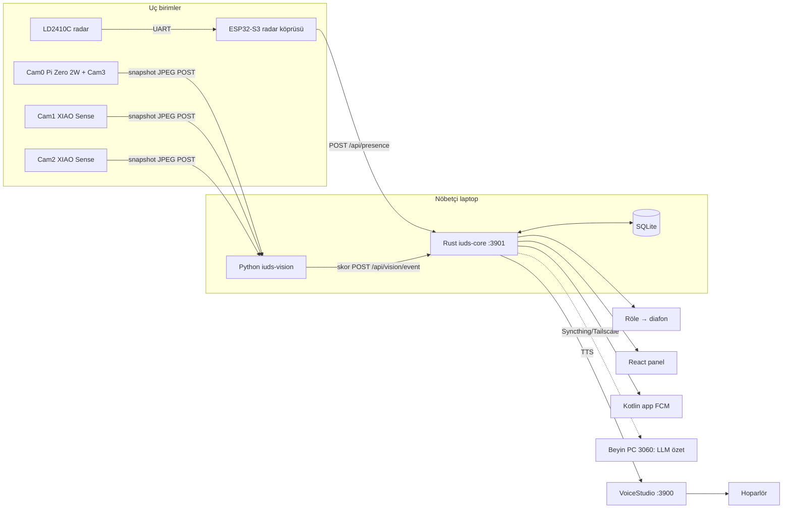
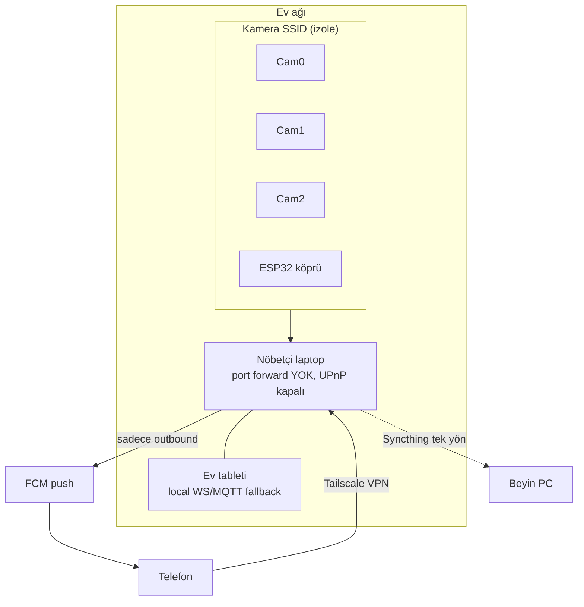
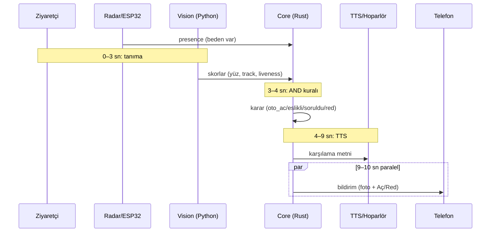
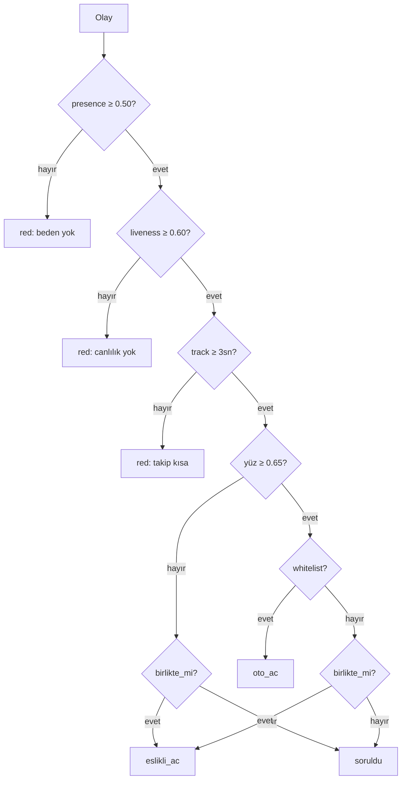

# 15 — Çizim ve Yerleşim

Durum: çizimler 3 hedefe gider — staj raporu, kendi kurulum kılavuzu, PCB (opsiyonel).
Kurulum yeri: 3 katlı binanın girişi, 2×2m (alternatif 4×4m) alan.

## Araç haritası (neyi nerede çiz)

| Katman | Ne | Araç | Not |
|---|---|---|---|
| Sistem | Blok, ağ, akış, zamanlama, AND kuralı | **Mermaid** (bu dosyada, docs'ta yaşar) | Rapor için PNG/SVG export |
| Yerleşim keşfi | 2×2/4×4 alana sürükle-bırak obje koyma | **Sweet Home 3D** (ücretsiz, offline) | "Şuraya koysam ne görür" denemeleri; 3D önizleme |
| Yerleşim 2D | Ölçekli plan + görüş konileri | **draw.io desktop** (grid 10cm) | Hızlı varyant karşılaştırma |
| Yerleşim rapor | Ölçekli mühendislik planı | **FreeCAD TechDraw** | Staj raporuna girecek kesin plan |
| Mekanik | Sahte PIR kutusu, lens yuvası → STL | **FreeCAD** | 3D baskıya hazır |
| Elektrik şema | Röle arayüzü, LD2410C↔ESP32-S3 köprü | **KiCad** | docs/04: "şema rapora girecek" |
| Analog doğrulama | Flyback diyot transient simülasyonu | **LTspice** | Rapora "simülasyonla doğrulama" |

Çizim sırası: Sweet Home 3D keşif → Mermaid set (aşağıda) → KiCad şemalar →
LTspice sim → FreeCAD TechDraw kesin plan (kapı ölçüleri gelince).

## Yerleşim rehberi (2×2 / 4×4 alan)

- Referans: kapı merkez (0,0). Cam0 kapıya direkt, yüz hizası (~1.5m), 30–50cm geride.
- Cam1 sağ: kapıdan 90cm ileride. Cam2 sol: simetrik. (docs/05)
- Görüş konileri: Cam3 standart **75°**; XIAO Sense (OV3660) **~65–70°** (doğrulanacak).
  Planda üçgen/sektör olarak çiz, kesişim = kapsanan alan.
- LD2410C: ±60° koni, ~5m. Panel arkasına (plastik/ahşap geçirir, metal GEÇİRMEZ).
- Hoparlör: kapı üstü iç hat, kablo daire içinden.
- Sweet Home 3D yöntemi: duvarları çek (2×2 veya 4×4 oda), kapı ekle,
  objeleri kamera/radar/hoparlör olarak yerleştir, 3D gezintiyle kontrol et.
- draw.io yöntemi: sayfa ölçeği 1cm=10cm, grid 10cm; duvar + kapı + koniler;
  her varyant ayrı katman (layer) → A/B karşılaştırma.

## Mermaid diyagram seti

### Sistem blok

### Ağ topolojisi

### Zil akışı (10 sn bütçe)

### AND kuralı (docs/02)

## KiCad şema listesi (donanımsız çizilebilir)

1. Röle arayüzü: ESP32 GPIO → optokuplör (PC817) → röle bobini → diafon kontağına
   paralel; flyback diyot (1N4007) bobin uçlarına; galvanik izolasyon notu.
2. Radar köprüsü: LD2410C UART (TX/RX, 5V) → ESP32-S3; OUT pini interrupt.
3. XIAO besleme + U.FL anten notu (şema değil, bağlantı notu).

## LTspice simülasyonu (rapora doğrulama)

- Röle bobini kapatma anı: diyotsuz vs 1N4007'li transient karşılaştırması.
- Optokuplör LED akımı: GPIO 3.3V → seri direnç hesabı (CTR sınırı).
