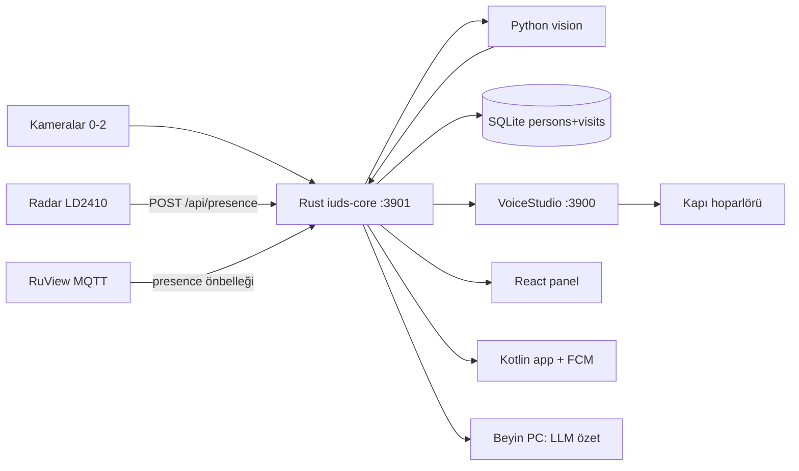

# 00 — BÜYÜK RESİM (IUDS)

Okuma yönü: her şey [[02-OnYuz-Iliskiler]] ve [[03-Api-Sozlesmesi]] üzerinden Rust'a dokunur. DB'ye kimse direkt yazmaz, tek yazar Rust'tır.

- Kişiler ve tablo detayı → [[01-Veritabani]]
- Ney neyi etkiler → [[04-Etki-Haritasi]]
- Kurallar → [[../docs/02-guvenlik|02-guvenlik]]
